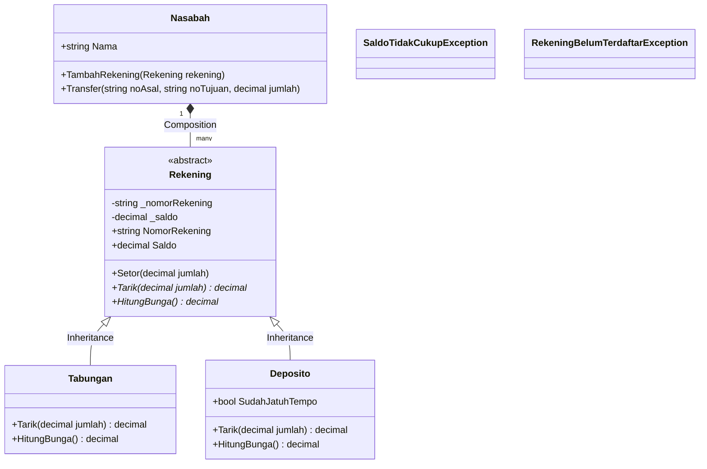

# Proyek ETS PBO

> Baca `SOAL.md` dulu. Ganti semua `TULIS_DI_SINI` di berkas ini, `AI-LOG.md`, dan `PROSES.md`. Berkas yang masih berisi
> `TULIS_DI_SINI` dianggap belum diisi.

## Identitas

- Nama: Sayyidah FatimaH Azzahrah Rakhmatullah
- NRP: 5025251223
- Domain (NRP dibagi 6, ambil sisanya): 3-Bank Mini

## Domain saya

Jelaskan dengan kata-kata sendiri (2-3 kalimat): siapa penggunanya dan masalah apa yang diselesaikan aplikasi ini.

Aplikasi Bank Mini ini mengelola rekening nasabah seperti Tabungan dan Deposito dengan aturan penarikan dan bunga yang berbeda-beda. Aplikasi ini memastikan keamanan transaksi serta transfer antar rekening menggunakan penanganan _exception_. Selain itu, data riwayat transaksi dilindungi dengan enkapsulasi agar aman dan tidak bisa diubah sembarangan dari luar.

## Cara menjalankan

```bash
dotnet build proyek/src
dotnet run --project proyek/src
```

## Diagram kelas

Ganti contoh ini dengan diagram kelas proyek kalian (sintaks Mermaid, tampil otomatis di GitHub).



## Status kebutuhan

Isi kolom Status dengan `selesai`, `sebagian`, atau `belum`.

| ID    | Kebutuhan                    | Status        | Catatan |
| ----- | ---------------------------- | ------------- | ------- |
| K1    | Enkapsulasi                  | TULIS_DI_SINI |         |
| K2    | Komposisi dan pewarisan      | TULIS_DI_SINI |         |
| K3    | Polimorfisme                 | TULIS_DI_SINI |         |
| K4    | Abstract class dan interface | TULIS_DI_SINI |         |
| K5    | Exception dan life cycle     | TULIS_DI_SINI |         |
| K6    | Aplikasi berjalan            | TULIS_DI_SINI |         |
| Khas  | Aturan khas domain           | TULIS_DI_SINI |         |
| Bonus | Bonus yang dikerjakan        | TULIS_DI_SINI |         |

## Yang belum selesai

TULIS_DI_SINI (tulis "tidak ada" bila semuanya selesai)
